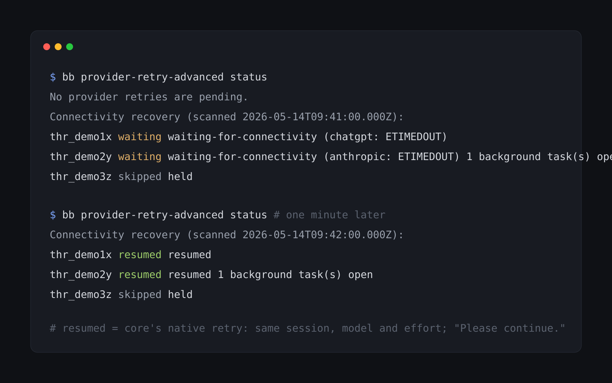

# bb-plugin-provider-retry-advanced

BB plugin: provider retry plus automatic resume after lost connectivity.



[](https://github.com/neoromantic/bb-plugin-provider-retry-advanced/actions/workflows/ci.yml)
[](https://github.com/neoromantic/bb-plugin-provider-retry-advanced/releases)
[](LICENSE)

An unofficial fork of the **Provider retry** plugin bundled with [BB](https://github.com/get-bb/bb).
It does everything that plugin does, and it also resumes Codex and Claude Code turns that failed
because the provider or the thread's machine could not be reached, once it can be reached again.

## Install

Needs BB 0.46.1 or later. Run one retry plugin, not both, so disable the bundled one first:

```sh
bb plugin disable provider-retry
bb plugin install git:https://github.com/neoromantic/bb-plugin-provider-retry-advanced.git@semver:^0.1.0 --yes
```

## Quickstart

A fresh install only observes: BB starts a plugin enabled and its first scan runs at load, so
nothing is retried until you `arm` it. Hold any thread that must stay paused first.

```sh
bb provider-retry-advanced status                # what it would resume
bb provider-retry-advanced hold <thread-id>      # optional: never auto-resume this thread
bb provider-retry-advanced arm                   # start; needed once, kept across reloads and restarts
```

From then on it checks when it loads and 60 seconds after each scan.

## Features

- Resumes turns that failed for lost connectivity: `connection-failed`, `stream-disconnected`,
  Account Pooler "could not reach", socket timeouts and resets, or a lost connection to the
  thread's machine. A provider's own 5xx, auth, billing, quota and overload errors do not count.
- Probes before it retries: one unauthenticated HEAD to the provider's API. An answer below 500
  only shows the API edge is reachable, not that your account or Account Pooler is healthy. No
  token, model or usage call; with nothing waiting it sends nothing.
- No attempt limit and no backoff for connectivity failures; a fixed 60-second scan.
- Uses core's native retry: same provider session, model, effort, tier and permission mode.
  Accepted input continues with "Please continue."; nothing is re-sent or relaunched.
- Claude Code background work that outlived the failed turn, such as an ultracode workflow, keeps
  running in that session. BB Workflows runs are left to the workflow engine.
- Guards every automatic retry at dispatch: a hold, a cancel, a stop, or a newer failed turn
  withdraws it. Finds failures from before it was installed.
- Keeps the bundled overload and subscription-limit retries unchanged.

| | Provider retry (bundled) | Provider retry advanced |
| --- | --- | --- |
| Provider overload | retried, delay doubles, max 4 | same, unchanged |
| Subscription-window limit | retried after the reset, `maximumWait` | same, unchanged |
| Connection failed, stream disconnected, Account Pooler "could not reach", socket timeout/reset | not retried | resumed once the provider answers again |
| Connection to the thread's machine lost | not retried | queued until the machine reconnects |
| Failures from before the plugin loaded | no | yes, found by the first scan |
| Attempt limit for connectivity failures | – | none |
| Backoff for connectivity failures | – | none, fixed 60 s scan |


## Usage

```sh
bb provider-retry-advanced status [thread-id] [--json]   # pending retries and turns waiting for connectivity
bb provider-retry-advanced explain [thread-id] [--json]  # last decision for a thread
bb provider-retry-advanced retry <thread-id>             # send a pending retry now
bb provider-retry-advanced cancel <thread-id>            # delete it and stop recovering this failure
bb provider-retry-advanced hold <thread-id>              # never retry this thread automatically
bb provider-retry-advanced release <thread-id>           # undo hold and cancel
bb provider-retry-advanced arm [--json]                  # once after install
bb provider-retry-advanced scan [--json]                 # run the scan now
```

`explain` shows reasons such as `waiting-for-connectivity (anthropic: ETIMEDOUT)`. A hold also
withdraws the thread's queued retries from this plugin and blocks overload and limit retries.
Whoever pauses a thread outside BB's own stop is responsible for holding it and releasing it.

Settings:

```sh
bb plugin config provider-retry-advanced set transportRecovery false  # stop connectivity recovery
bb plugin config provider-retry-advanced set maximumWait "24 hours"   # bundled setting
```

Roll back to the bundled plugin:

```sh
bb plugin disable provider-retry-advanced
bb plugin enable provider-retry
bb plugin remove provider-retry-advanced   # also deletes its settings and holds
```

Retries already queued stay in the thread's queue as ordinary rows; cancel them on the queue card
if you no longer want them.

How the checks work, what is not resumed, compatibility and tests:
[docs/how-it-works.md](docs/how-it-works.md).

## Limits

- A tool call in flight when the connection dropped has an unknown outcome. The transcript and
  tool results are kept, but no plugin can guarantee exactly-once side effects.
- The checks before a retry are separate steps, not one transaction. A hold or stop that arrives
  after an attempt was let through does not undo it; stop that turn like any other.
- The probe runs from the BB server. For a remote machine it approximates the machine's path.

## For AI agents

Every command takes `--json`. The bundled skill `provider-retry-advanced` explains the plugin to
agents running in BB. The plugin RPC `decision.get` accepts `{ threadId }` and returns the last
decision, like the bundled plugin.

## Contributing, Security, License

- Contributing: [CONTRIBUTING.md](CONTRIBUTING.md). Checks: `bun run check && bun test`.
- Security: [SECURITY.md](SECURITY.md).
- License: [MIT](LICENSE). Forked from `plugins/provider-retry` of
  [get-bb/bb](https://github.com/get-bb/bb) at tag `desktop-v0.46.1` (MIT, Copyright (c) 2026
  Michael Yong); see [NOTICE](NOTICE).
